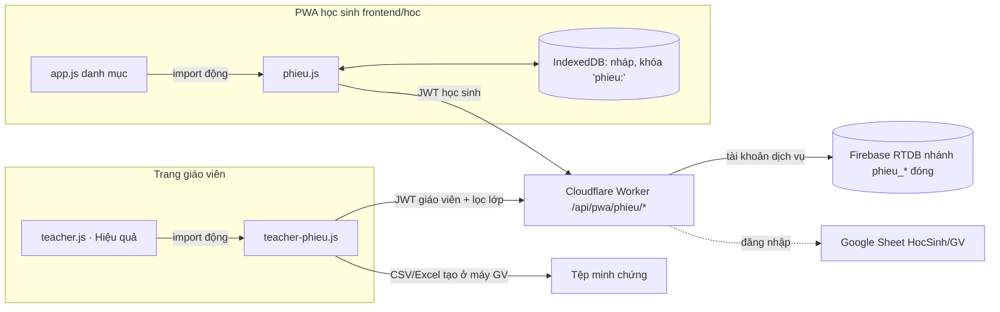

# 03. Kiến trúc tích hợp

## Trả lời ngắn: tích hợp vào đâu
| Phía | Vị trí | Lý do |
|---|---|---|
| Học sinh | **Mục điều hướng mới "Học AI"** (người dùng chọn 22/11/2026), đặt sau "Học", trước "Luyện tập". Trong đó: danh sách bài Giáo dục AI theo khối, mở bài thì hiện 6 hoạt động; mục "Hồ sơ của em" xem nhận xét theo YCCĐ. Mô-đun riêng `frontend/hoc/phieu.js`, nạp động khi mở | Giáo dục AI là mạch riêng (12 tiết/khối, đánh giá theo YCCĐ, không chấm điểm), khác "Học" (bài SGK có câu hỏi chấm tự động). Không chèn vào `catalog`, để bản PWA cũ đã cài không vỡ. Điện thoại: thanh dưới giữ 5 mục (Tổng quan, Học, Học AI, Luyện tập, Thi); **"Tài liệu" gộp vào trang "Học"** thành thẻ con "Bài học | Tài liệu" (người dùng chốt 22/11/2026). Màn rộng có thể giữ hoặc bỏ mục Tài liệu ở thanh bên, miễn nội dung không trùng hai nơi |
| Giáo viên | **Mục điều hướng mới "Học AI"** sau "Soạn bài", gồm 4 thẻ con: Bài học (mở bài/mở bước cho lớp, thẻ nghề địa phương), Bài làm (theo lớp, nhận xét 4 YCCĐ, trả bài), Nhóm (phiếu số 2, quan sát nhóm), Xuất minh chứng. Mô-đun `teacher-phieu.js` | Đủ chức năng riêng để thành phân hệ; đặt trong "Hiệu quả" hay "Tiện ích" sẽ lẫn với bản đồ năng lực và trò chơi lớp học |
| Máy chủ | Worker hiện có, nhóm route mới `/api/pwa/phieu/*` và `/api/pwa/teacher/phieu/*` | Lấy `uid`, `class_code` từ JWT; giáo viên lớp lọc theo `requireTeacher().user.classes` |
| Dữ liệu | RTDB hiện có, các nhánh mới `phieu_*`, **chỉ Worker đọc/ghi** | Gốc luật đã `.read/.write:false`, nên nhánh mới tự đóng; không cần sửa và deploy luật |
| Nội dung | Gói phiếu dạng JSON (`phieu_bo/{packId}`), đáp án GV riêng (`phieu_dapan/{packId}`) | Bài 2 là gói đầu tiên; Bài 1, 3–8 và các lớp 6–8 thêm bằng dữ liệu, không sửa mã |

Không tạo dự án Firebase mới, không dùng Firestore, đăng nhập ẩn danh hay `roles/{uid}` của ứng dụng Bài 2.

## Tính mở: giáo viên sửa được toàn bộ nội dung (người dùng chốt 22/11/2026, bắt buộc)
Giáo viên sửa mọi thứ trong gói **ngay trên trang giáo viên** (thẻ con "Bài học" của "Học AI"), không sửa mã, không deploy lại:
- học liệu (`blocks`): tin tuyển dụng, tình huống, thẻ năng lực, thẻ nghề (sửa, thêm thẻ địa phương, ẩn thẻ), bảng mục tiêu mẫu, ví dụ mẫu;
- hoạt động: tên, thời lượng, nhiệm vụ, câu hỏi suy nghĩ, lưu ý; thêm, ẩn, đổi thứ tự;
- trường nhập: nhãn, gợi ý, độ dài, bắt buộc/không, lựa chọn, mã YCCĐ, loại minh chứng; thêm, ẩn;
- YCCĐ, thang mức, đáp án và tiêu chí Đạt/Khá/Tốt, kết luận chốt, mẫu nhận xét (gói đáp án GV).

Quy tắc dữ liệu để sửa an toàn:
1. **Bản gốc bất biến** `phieu_bo_goc/{packId}` (nạp một lần từ `data/phieu/*.json`). Bản đang dùng `phieu_bo/{packId}` có `rev`, `sua_boi`, `sua_luc`. Giáo viên luôn có nút "Khôi phục bản gốc" (từng mục hoặc cả gói), có xác nhận theo mục J. Màn giáo viên đánh dấu mục nào **đã sửa so với gốc**, để phân biệt nội dung gốc với chỉnh sửa.
2. **Mã trường (`id`) không bao giờ đổi hay tái sử dụng.** Sửa nhãn giữ nguyên `id`. "Xóa" trường là đặt `an:true`, câu trả lời cũ vẫn giữ và vẫn xuất CSV. Trường mới tự sinh `id` mới.
3. Mỗi bài làm lưu `pack_rev` lúc nộp; giáo viên xem bài theo đúng phiên bản gói em đã làm.
4. Sửa gói khi lớp đang làm: giao diện học sinh nhận bản mới ở lần mở sau, nháp không mất (vì `id` ổn định).
5. Phạm vi sửa: quản trị sửa gói chung; giáo viên lớp có thể tạo **bản riêng cho lớp mình** (`phieu_bo_lop/{packId}/{lopKey}`, chỉ ghi phần khác) mà không ảnh hưởng lớp khác. Cần thầy xác nhận khi làm giai đoạn 7.
6. Worker kiểm gói sau sửa bằng cùng hàm `validatePack` (mỗi YCCĐ còn ít nhất một trường minh chứng tối thiểu; không có `id` trùng). Nếu sai thì từ chối lưu và báo lỗi tiếng Việt.

## Sơ đồ


## Gói phiếu (dữ liệu, không phải mã)
```json
{
  "id": "ai9_bai2", "schema": 1, "grade": 9, "title": "Bài 2. Học tập, thể hiện bản thân và định hướng nghề nghiệp trong thế giới AI",
  "yccd": [{"code": "9.A3.1", "text": "…nguyên văn KHBD…"}],
  "ai_tutor": false,
  "activities": [
    {"id": "hd1", "title": "Tuyển dụng năm 2035", "minutes": 5, "mode": "ca_nhan", "source": "PL9.2.1; PL9.2.2 dòng đầu",
     "blocks": [{"type": "doc", "ref": "pl921"}],
     "fields": [
       {"id": "hd1_chon", "type": "multi", "options_ref": "the_tuyen_dung", "exact": 3, "lock": "chot_dau_gio",
        "evidence": {"kind": "moc"}},
       {"id": "hd1_vi", "type": "textarea", "max": 600, "lock": "chot_dau_gio", "evidence": {"kind": "moc"}}
     ]},
    {"id": "hd21", "mode": "ca_nhan", "fields": [
       {"id": "a_t1_nl", "type": "choice", "options_ref": "sau_nang_luc", "evidence": {"code": "9.A3.1", "kind": "toi_thieu"}},
       {"id": "a_t1_lam", "type": "text", "max": 120, "evidence": {"code": "9.A3.1", "kind": "toi_thieu"}},
       {"id": "a_t1_em", "type": "scale3", "labels": ["thường làm được", "đôi khi", "chưa làm được"], "evidence": {"kind": "tu_danh_gia"}}
    ]},
    {"id": "hd23", "mode": "nhom", "fields": ["…cột 1–4, phân công, trạm…"]}
  ],
  "reveal": [{"block": "pl928_trang2", "after_field": "d_vd2_hoilai"}]
}
```
- `evidence.kind`: `toi_thieu` | `bo_tro` | `moc` | `tu_danh_gia` | `khong_cham`. Màn giáo viên và tệp CSV nhóm trường theo `code` và `kind`, không tự tính mức.
- `lock`: Worker từ chối sửa trường đã khóa (giữ "Lúc đầu em chọn…").
- `mode: "nhom"`: dữ liệu ghi vào thực thể nhóm, không vào hồ sơ cá nhân.
- Đáp án/gợi ý GV (PL9.2.9) **không** nằm trong gói học sinh.

## Luồng chính
1. **Học sinh mở phiếu:** `GET /api/pwa/phieu/ai9_bai2` → gói nội dung + bài của em + nhóm của em. Lưu bản sao vào IndexedDB (dùng store sẵn có `drafts` của CSDL `aisgk-student-pwa` phiên bản 1, khóa tiền tố `phieu:`; không thêm store để khỏi tăng phiên bản DB).
2. **Lưu nháp:** tự lưu cục bộ khi gõ; gửi `PUT …/draft` kèm `rev`. Worker trả 409 nếu `rev` cũ (đang mở ở máy khác), rồi giao diện hỏi bằng `<dialog>`.
3. **Nộp:** `POST …/submit` → trạng thái `submitted`, Worker ghi bản chụp bất biến `phieu_ls`.
4. **Giáo viên yêu cầu bổ sung:** trạng thái `returned`, học sinh sửa rồi nộp lại (`rev` tăng, bản chụp mới).
5. **Giáo viên nhận xét:** mức theo từng YCCĐ + phần còn thiếu + cách hỗ trợ; có lịch sử.
6. **Nhóm:** học sinh chọn số nhóm do GV đặt; thành viên cùng sửa phiếu số 2; mỗi lần lưu ghi `uid` và trường đã sửa.
7. **Xuất minh chứng:** trang giáo viên tạo CSV (UTF-8 có BOM) ngay trên máy, theo lớp, theo bốn YCCĐ; vô hiệu hóa ký tự đầu `= + - @ \t \r`.

## Tái sử dụng / phát triển mới
| Tái sử dụng | Phát triển mới |
|---|---|
| Đăng nhập, JWT, `requireTeacher`, khóa sai PIN, CORS (Worker) | Route `phieu`, kiểm tra theo lược đồ gói |
| `rtdb()` tài khoản dịch vụ | Nhánh `phieu_*`, ghi bản chụp bất biến |
| `api.js`, `ApiError`, `mapErrorMessage`, `withBusy`, `setFieldError`, `confirmBox` (`dom.js`) | `phieu.js` dựng phiếu từ gói (trường văn bản, chọn, thang 3, nhiều lựa chọn có giới hạn) |
| IndexedDB `db.js`, đóng dấu `sw.js` | `teacher-phieu.js`: danh sách theo lớp, xem bài, so sánh bản, nhận xét, quan sát nhóm, CSV |
| Giao diện, phông SGK Serif, biến màu | Công cụ nạp gói `tools/upload_phieu_pack.py` (giai đoạn sau: soạn gói trong trang GV) |
