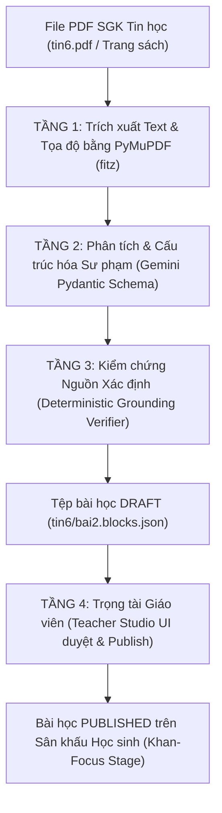

# KẾ HOẠCH CHI TIẾT: ĐƯỜNG ỐNG TỰ ĐỘNG BÓC TÁCH SGK TIN HỌC THCS THÀNH DỮ LIỆU BLOCK SCHEMA CHUẨN SƯ PHẠM (PHASE 6.1)

> **Mã kế hoạch**: `PLAN-SGK-EXTRACTION-PIPELINE-2026`  
> **Phiên bản**: V1.0  
> **Mục tiêu**: Xây dựng đường ống tự động hóa bóc tách nội dung Sách giáo khoa Tin học THCS (Lớp 6–9) từ file PDF/Văn bản thô thành cấu trúc dữ liệu số hóa tương tác `blocks.json` (Block Schema 2.0), tích hợp kiểm chứng nguồn xác định (Deterministic Grounding) và giàn giáo sư phạm Socrates 3 tầng.

---

## 1. PHÂN TÍCH BẢN CHẤT DỮ LIỆU & THÁCH THỨC KỸ THUẬT

### 1.1. Đặc thù của Sách giáo khoa Tin học in (GDPT 2018)
1. **Bố cục phức tạp đa khối (Multi-column & Visual Callouts)**:
   - SGK in không trình bày dạng văn bản tuần tự 1 cột như tiểu thuyết, mà bố trí thành nhiều hộp nội dung: Khởi động, Khám phá kiến thức (2 cột text + hình minh họa), Hoạt động nhóm, Hộp ghi nhớ và Luyện tập - Vận dụng.
   - Nếu trích xuất văn bản đơn giản (như copy-paste hoặc OCR thông thường), text sẽ bị dính dòng giữa cột trái và cột phải, làm sai lệch ngữ nghĩa.
2. **Khế ước Trung thực về Đáp án (The Grounding Invariant)**:
   - Sách giáo khoa in cho học sinh **HOÀN TOÀN KHÔNG IN ĐÁP ÁN ĐÚNG HAY GIẢI THÍCH CHI TIẾT** cho các bài tập cuối bài.
   - Do đó, câu hỏi (`cau_hoi`) và các phương án lựa chọn (`lua_chon`) có thể đối chiếu so khớp với văn bản in trong sách; còn đáp án đúng (`dap_an_dung`), giải thích khi đúng (`giai_thich_su_pham`) và gợi ý khi sai (`goi_y_khi_sai`) **bắt buộc phải do AI suy luận sư phạm sinh ra (`source: "generated"`)** và phải được **Giáo viên xác nhận (`source: "teacher_verified"`)**.
3. **Giàn giáo Sư phạm Socrates 3 Tầng**:
   - Câu hỏi trắc nghiệm không chỉ cần đáp án đúng/sai, mà cần sinh kèm gợi ý tư duy khi học sinh làm sai (`goi_y_khi_sai`) theo triết lý Socrates: **Chỉ ra ngộ nhận tư duy và dẫn dắt học sinh đọc lại mục tương ứng trong sách, tuyệt đối không tiết lộ đáp án trực tiếp**.

---

## 2. KIẾN TRÚC ĐƯỜNG ỐNG BÓC TÁCH 4 TẦNG (4-TIER PIPELINE)

### Tầng 1: Trích xuất thô & Phân đoạn trang (Raw Extraction & Page Segmentation)
- Sử dụng **`PyMuPDF` (`fitz`)**:
  - Đọc trực tiếp cấu trúc cây trang PDF với tốc độ cực nhanh (< 50ms/trang).
  - Tách nội dung theo từng trang số thực tế của sách (`pages_dict[page_num]`).
  - Phân đoạn nhận diện tiêu đề bài học (Regex matching: `BÀI \d+: .*`, `CHỦ ĐỀ [A-F]`).

### Tầng 2: Cấu trúc hóa Sư phạm thành Block Schema (Pedagogical Structuring via Gemini Pydantic)
- Áp dụng kỹ thuật **Gemini Structured Outputs** với Pydantic Model nghiêm ngặt:
  - Sinh mảng `blocks`:
    - `hero`: Tiêu đề, badge chương/bài, mô tả trực quan.
    - `goals`: Các mục tiêu cần đạt theo chuẩn bài học.
    - `comparison_table` / `grid_cards`: Chia nhỏ nội dung lý thuyết thành các khối so sánh, thẻ trực quan giúp học sinh THCS dễ tiếp thu.
    - `takeaways`: Các ý tóm tắt trọng tâm (tương đương hộp Ghi nhớ trong SGK).
  - Sinh mảng `quiz`:
    - Tách từng câu hỏi bài tập thành cấu trúc: `id`, `cau_hoi`, `lua_chon` (A, B, C, D), `muc_sgk`, `trang_sgk`.
    - Sinh `giai_thich_su_pham` (khi đúng) và `goi_y_khi_sai` (gợi mở tư duy không lộ đáp án).
    - Đặt mặc định: `source = "generated"`, `grounding_verified = false`.

### Tầng 3: Kiểm chứng Nguồn Xác định (Deterministic Grounding Gatekeeper)
- Gọi module có sẵn [`backend/grounding_verifier.py`](file:///c:/Users/HPZBook/Desktop/AI%20AGENT%20SGK/backend/grounding_verifier.py):
  - Chuẩn hóa Unicode NFC và làm sạch khoảng trắng.
  - So khớp `cau_hoi` và 4 phương án lựa chọn với trang PDF nguồn theo thuật toán SequenceMatcher với ngưỡng $\ge 80\%$.
  - Nếu khớp $\ge 80\% \to$ Tự động bật `grounding_verified = true`.
  - Nếu phát hiện AI bịa thêm câu hỏi không có trong sách $\to$ Giữ `grounding_verified = false` và gắn cờ cảnh báo cho Giáo viên.

### Tầng 4: Phê duyệt Giáo viên & Xuất bản (Teacher Studio Gatekeeper)
- Tệp sinh ra được lưu tự động ở trạng thái `status: "draft"` tại `data/curriculum/tin{grade}/bai{id}.blocks.json` kèm tệp sao lưu `.bak`.
- Giáo viên đăng nhập vào **Teacher Studio** (mã PIN bảo mật SHA-256), kiểm tra nội dung, điều chỉnh nếu cần và nhấn "Xác thực & Xuất bản" (`published`).

---

## 3. KẾ HOẠCH TRIỂN KHAI CHI TIẾT (ACTIONABLE TASKS)

### Task 1: Xây dựng Module Định nghĩa Schema và Công cụ Trích xuất CLI
- [ ] **1.1**: Định nghĩa Pydantic Contract `LessonExtractionContract` trong `backend/contracts.py` khớp 100% với `Block Schema 2.0`.
- [ ] **1.2**: Viết script trích xuất đa năng `tools/extract_lesson_pipeline.py`:
  - Hỗ trợ chế độ nạp trực tiếp file PDF (`--pdf path/to/tin6.pdf --lesson 2 --start-page 8 --end-page 11`).
  - Hỗ trợ chế độ nạp văn bản thô/Markdown nếu chưa có file PDF (`--raw-text path/to/lesson2_raw.md`).
- [ ] **1.3**: Tích hợp hàm `extract_text_by_page_from_pdf` và bộ xác thực `verify_quiz_item_grounding`.

### Task 2: Soạn thảo Prompt Kỹ nghệ Sư phạm cho Bộ trích xuất Gemini
- [ ] **2.1**: Thiết kế `EXTRACTION_SYSTEM_PROMPT` trong `tools/extract_lesson_pipeline.py`:
  - Yêu cầu AI giữ nguyên 100% câu hỏi và phương án A, B, C, D của SGK in.
  - Hướng dẫn AI tạo `giai_thich_su_pham` ngắn gọn, tích cực.
  - Ép buộc AI tạo `goi_y_khi_sai` theo chuẩn Socrates: Chỉ ra câu hỏi phản tư, cấm nói *"chọn đáp án..."*.
- [ ] **2.2**: Thiết lập fallback thông minh: Nếu không có API Key, cho phép nạp bản thảo JSON mẫu có sẵn cấu trúc.

### Task 3: Bóc tách Thử nghiệm và Xuất bản Bài 2 Tin học 6 ("Xử lý thông tin")
- [ ] **3.1**: Chuẩn bị dữ liệu nội dung SGK Bài 2 Tin học 6:
  - Mục 1: Xử lý thông tin là gì? (Quy trình 4 bước: Thu nhận $\to$ Xử lý $\to$ Lưu trữ $\to$ Truyền đạt).
  - Mục 2: Máy tính là công cụ hiệu quả để xử lý thông tin.
  - Bài tập luyện tập & Vận dụng cuối bài.
- [ ] **3.2**: Chạy pipeline xuất ra file `data/curriculum/tin6/bai2.blocks.json` ở trạng thái `draft`.
- [ ] **3.3**: Chạy xác thực `grounding_verifier` trên Bài 2.

### Task 4: Nâng cấp Backend và Frontend Hỗ trợ Đa Bài học (Multi-Lesson Navigation)
- [ ] **4.1**: Cập nhật `backend/server.py` bổ sung endpoint danh sách bài học `/api/lessons/{grade}` để học sinh chọn chuyển bài (Bài 1 $\to$ Bài 2 $\to$ Bài 3).
- [ ] **4.2**: Bổ sung bộ chọn bài học (Lesson Selector Dropdown / Breadcrumbs) trên thanh Header của `frontend/index.html` và `frontend/app.js`.
- [ ] **4.3**: Kiểm tra chuyển đổi giữa Bài 1 và Bài 2 mượt mà, giữ nguyên tính năng Gia sư Socrates và chấm điểm trắc nghiệm.

### Task 5: Kiểm định Zero-Bug Toàn diện (Multi-Agent Audit & Test Suite)
- [ ] **5.1**: Viết unit test tự động trong `tests/test_curriculum_extraction.py` kiểm tra:
  - Cấu trúc `bai2.blocks.json` hợp lệ theo Pydantic schema.
  - Trắc nghiệm Bài 2 không bị rò rỉ đáp án ở client.
  - Động cơ Socrates trả lời đúng ngữ cảnh Bài 2.
- [ ] **5.2**: Chạy toàn bộ test suite Pytest đảm bảo giữ vững thành tích 100% PASS.
- [ ] **5.3**: Chạy Playwright E2E kiểm tra học sinh làm bài trên Bài 2.

---

## 4. CÂU HỎI MỞ CẦN THỐNG NHẤT VỚI BẠN

Để triển khai chính xác nhất theo ý bạn:
1. **Nguồn sách hiện tại**: Bạn đã có sẵn tệp PDF Sách giáo khoa Tin học 6 (Bộ Kết nối tri thức hay Cánh diều) trên máy tính chưa? (Nếu chưa có sẵn file PDF, tôi có thể cung cấp sẵn văn bản bài học chuẩn GDPT 2018 của **Bài 2: Xử lý thông tin** để chạy bóc tách mẫu ngay).
2. **Bộ sách ưu tiên**: Bạn muốn hệ thống theo bộ sách nào: **Kết nối tri thức với cuộc sống**, **Cánh diều**, hay **Chân trời sáng tạo**? (Bài 1 hiện tại được thiết kế theo cấu trúc chuẩn của bộ Kết nối tri thức).
