# HỒ SƠ THẨM ĐỊNH KIẾN TRÚC & PHẢN BIỆN CHIẾN LƯỢC
## DỰ ÁN: GIA SƯ AI SGK TIN HỌC THCS (`AI AGENT SGK`)
### CHỦ ĐỀ: TÁI CẤU TRÚC CHIẾN LƯỢC NẠP HỌC LIỆU: BÓC TÁCH SGK PDF THỦ CÔNG VS. GOOGLE NOTEBOOKLM (MCP) VS. GEMINI LONG-CONTEXT FILE API VS. HỌC LIỆU INTERNET SẠCH

- **Thời gian lập hồ sơ**: 2026-10-15T21:50:00+07:00
- **Mã hồ sơ Ledger**: `1792075848696-sgk-extraction-vs-notebooklm-architectural-dossier`
- **Tác giả đề xuất**: Kỹ sư Trưởng Hệ thống (`AI AGENT SGK`)
- **Đơn vị thẩm định độc lập**: Claude 3.5 Sonnet (Architectural Auditor)

---

## I. BỐI CẢNH VÀ NỖI ĐAU THỰC TẾ (PAIN POINTS & INVARIANTS)

### 1. Hiện trạng Hệ thống
Dự án đã xây dựng hoàn chỉnh nền tảng:
- **Web Frontend**: Sân khấu học tập tương tác Khan-Focus chiếm $\ge 85\text{vh}$, hiển thị động theo Block Schema 2.0 (`hero`, `takeaways`, `comparison_table`, `grid_cards`, `flashcards`, `quiz_group`, `socratic_dialogue`).
- **Backend Socratic Agent**: FastAPI + Gemini API, bảo vệ sư phạm nghiêm ngặt (Anti-Leak Invariant: 0% lộ đáp án, bắt buộc giàn giáo gợi ý 3 tầng).
- **Curriculum Store**: Cấu trúc JSON tại `data/curriculum/tin{grade}/bai{lesson}.blocks.json`. Hiện đã có `bai1.blocks.json` (published) và `bai2.blocks.json` (draft).

### 2. Nỗi đau trong quy trình nạp dữ liệu hiện tại (PDF Extractor qua Tkinter GUI)
Nhóm phát triển đã triển khai công cụ Desktop `tools/sgk_studio_gui.py` sử dụng **PyMuPDF (`fitz`) + Gemini Vision API** để giáo viên bóc tách thủ công từ file PDF scan/in của Nhà xuất bản.
Tuy nhiên, khi vận hành thực tế bộc lộ 3 vấn đề nghiêm trọng:
1. **Rào cản nhân lực & Thời gian**: Để số hóa toàn bộ chương trình Tin học 6, 7, 8, 9 (khoảng 60 bài học), giáo viên/kỹ sư phải dò từng trang in, nhập offset PDF, cấu hình và rà soát thủ công từng bài trên giao diện Tkinter.
2. **Layout PDF phức tạp & Lỗi OCR**: Sách giáo khoa GDPT 2018 trình bày dạng tạp chí đa cột, các hộp text đan xen hình ảnh khiến việc phân đoạn khối văn bản dễ bị đảo lộn trật tự logic sư phạm.
3. **Sự tồn tại của các công nghệ thay thế hiện đại hơn**:
   - **Học liệu Internet đã số hóa**: Các trang giáo dục lớn (VietJack, Loigiaihay, Tuyensinh247) đã có sẵn toàn bộ văn bản lý thuyết và câu hỏi trắc nghiệm của SGK dạng HTML sạch 100%.
   - **Google NotebookLM & MCP**: NotebookLM cho phép nạp toàn bộ cuốn sách PDF (hàng trăm trang), tự động xây dựng chỉ mục vector RAG chuẩn xác 100% kèm trích dẫn (Citations). Cộng đồng đã phát triển các MCP server (`PleasePrompto/notebooklm-mcp`, `jacob-bd/notebooklm-mcp-cli`) cho phép AI kết nối trực tiếp.
   - **Google Gemini Long-Context File API**: Google GenAI SDK chính thức hỗ trợ tải nguyên file PDF sách lên File API (1M+ tokens context), kết hợp Structured JSON Output với Pydantic Contract để xuất thẳng sang Block Schema 2.0 chỉ bằng 1 lệnh script duy nhất.

---

## II. CHI TIẾT 4 PHƯƠNG ÁN KIẾN TRÚC

```mermaid
flowchart TD
    subgraph OPT1["Phương án 1: Hiện tại (Local PDF + Tkinter Studio)"]
        A1["PDF SGK Cục bộ"] --> B1["PyMuPDF + Tkinter Studio GUI"]
        B1 --> C1["Gemini Vision API"]
        C1 --> D1["JSON Block Schema 2.0 (Thủ công từng bài)"]
    end

    subgraph OPT2["Phương án 2: Google NotebookLM qua MCP Bridge"]
        A2["PDF Nguyên cuốn SGK"] --> B2["Google NotebookLM (Web UI)"]
        B2 --> C2["NotebookLM MCP Bridge (Unofficial / Headless)"]
        C2 --> D2["AntiGravity Agent Query"]
        D2 --> E2["Sân khấu Tự học / Chat Socrates"]
    end

    subgraph OPT3["Phương án 3: Gemini 2.5 Long-Context File API (Đề xuất chính thống)"]
        A3["PDF Nguyên cuốn SGK"] --> B3["Google AI File API (1M+ Token Context)"]
        B3 --> C3["Gemini 2.5 Flash / Pro (Structured Pydantic Contract)"]
        C3 --> D3["JSON Block Schema 2.0 (100% Tự động Batch)"]
    end

    subgraph OPT4["Phương án 4: Internet Curated HTML Pipeline"]
        A4["Học liệu Web HTML Sạch"] --> B4["Python Web Crawler / Parser"]
        B4 --> C4["Gemini Socratic Reformatter"]
        C4 --> D4["JSON Block Schema 2.0"]
    end
```

### 1. Phương án 1 (Baseline - Desktop Tkinter + PyMuPDF)
- **Cơ chế**: Cắt trang PDF cục bộ bằng `fitz`, gửi ảnh/text sang Gemini Vision, hiển thị trên Tkinter GUI để giáo viên sửa rồi lưu file JSON.
- **Ưu điểm**: Bám sát 100% bản in NXB; giáo viên có quyền kiểm duyệt trước khi lưu.
- **Nhược điểm**: Nặng nề, tốn công sức, dễ lỗi encoding Tkinter trên Windows, không tự động hóa quy mô lớn.

### 2. Phương án 2 (Google NotebookLM qua MCP Server)
- **Cơ chế**: Tạo Notebook trong Google NotebookLM, upload nguyên cuốn PDF SGK. Dùng `notebooklm-mcp` (chạy qua cookie xác thực hoặc Playwright) để AI Agent trong AntiGravity gửi câu hỏi và nhận câu trả lời RAG có trích dẫn trang.
- **Ưu điểm**: Khả năng tổng hợp và trích dẫn chuẩn mực; không cần code parser PDF; giao diện NotebookLM thân thiện.
- **Nhược điểm kỹ thuật**:
  - Google **chưa có API chính thức** cho NotebookLM. Mọi MCP hiện tại đều là **Reverse-Engineered** (dùng session cookie cá nhân hoặc headless browser). Session hết hạn liên tục, dễ bị khóa tài khoản hoặc lỗi khi Google đổi UI.
  - NotebookLM được tối ưu cho văn bản hội thoại đàm thoại tự do, rất khó ép kiểu xuất JSON cấu trúc chuẩn Pydantic `LessonBlockPackageContract` phục vụ dựng giao diện Web.

### 3. Phương án 3 (Gemini 2.5 Long-Context File API - Đề xuất cải tiến chính thống)
- **Cơ chế**: Dùng chính `GEMINI_API_KEY` hiện có của dự án. Upload file PDF nguyên cuốn sách giáo khoa (100-200 trang) lên Google File API (`client.files.upload`). Viết script `tools/batch_extract_sgk_gemini.py` gọi Gemini 2.5 Pro với:
  - Tham số: `response_mime_type="application/json"`
  - Ràng buộc: `response_schema=LessonBlockPackageContract`
  - Prompt: *"Trích xuất toàn bộ Bài X từ trang A đến trang B trong tài liệu PDF đã nạp thành cấu trúc Block Schema 2.0 chuẩn mực"*.
- **Ưu điểm**:
  - **Chính thống 100%**: Sử dụng Google GenAI SDK chính thức có SLA doanh nghiệp, không phụ thuộc cookie lậu hay browser automation.
  - **Đảm bảo tính bất biến (Type-Safe)**: Trả về JSON khớp 100% Pydantic Contract, không bị sai lệch kiểu dữ liệu.
  - **Tự động hóa hoàn toàn**: Một lệnh chạy có thể sinh hàng loạt toàn bộ 15 bài học trong vài phút mà không cần mở GUI Tkinter.
  - **Chi phí & Token**: Tận dụng Context Caching của Gemini để giảm 75% chi phí token khi truy vấn nhiều bài từ cùng một cuốn sách.

### 4. Phương án 4 (Cào học liệu HTML sạch từ Internet)
- **Cơ chế**: Viết crawler lấy nội dung bài giảng và câu hỏi trắc nghiệm đã được các trang web giáo dục (VietJack, Loigiaihay) biên soạn sẵn dạng HTML sạch. Sau đó dùng LLM format lại thành Block Schema 2.0.
- **Ưu điểm**: Tốc độ cực nhanh (< 2 giây/bài), văn bản sạch, không lo lỗi OCR hay lệch cột.
- **Nhược điểm**: Rủi ro pháp lý/bản quyền từ bên thứ ba; nội dung có thể đã bị biên tập lại, không hoàn toàn trùng khớp với bản in chuẩn của Bộ GD&ĐT.

---

## III. MA TRẬN SO SÁNH ĐA CHIỀU (EVALUATION MATRIX)

| Tiêu chí Đánh giá | PA 1: Tkinter Cục bộ | PA 2: NotebookLM MCP | PA 3: Gemini File API (Đề xuất) | PA 4: Cào Web HTML |
| :--- | :--- | :--- | :--- | :--- |
| **Độ chính xác nguyên bản SGK** | Cao (PDF gốc) | Rất cao (RAG trích dẫn trang) | **Tuyệt đối** (Doc AI 1M token) | Trung bình (web biên soạn lại) |
| **Tốc độ & Tự động hóa** | Rất chậm (thủ công từng bài) | Nhanh (hỏi đáp RAG) | **Cực nhanh** (Script Batch tự động) | Cực nhanh (Parser HTML) |
| **Độ ổn định Production** | Cao (chạy local) | **Kém** (MCP Reverse-Engineered) | **Tuyệt đối** (Google SDK chính thức) | Trung bình (web đổi DOM) |
| **Đầu ra Block Schema 2.0** | Khá (qua GUI) | Kém (text đàm thoại tự do) | **Hoàn hảo** (Pydantic Structured Output) | Khá (LLM format lại) |
| **Bảo vệ Sư phạm Socratic** | Đạt chuẩn | Cần prompt kỹ | **Đạt chuẩn** (Ràng buộc schema) | Cần lọc bỏ giải hộ |
| **Tính pháp lý & Bản quyền** | Chuẩn SGK Bộ GD&ĐT | Chuẩn SGK Bộ GD&ĐT | Chuẩn SGK Bộ GD&ĐT | Rủi ro bản quyền bên thứ 3 |
| **Chi phí vận hành** | Miễn phí/Rất thấp | Miễn phí (nhưng rủi ro acc) | Rất thấp (Gemini Flash/Pro File API) | Miễn phí |

---

## IV. CÁC CÂU HỎI CẦN CLAUDE 3.5 SONNET THẨM ĐỊNH

1. **Về NotebookLM MCP (Phương án 2)**:
   - Dưới góc nhìn kỹ sư hệ thống, việc đưa một giải pháp MCP không chính thức (dựa trên session cookie và web scraping ngầm) vào production/pipeline có phải là một "Technical Debt" nguy hiểm không?
   - Có nên phân tách vai trò: Dùng NotebookLM làm công cụ hỗ trợ người phát triển nghiên cứu tài liệu (research tool), nhưng KHÔNG gắn vào runtime pipeline của ứng dụng?

2. **So sánh Phương án 2 (NotebookLM MCP) và Phương án 3 (Gemini 2.5 Long-Context File API)**:
   - Khi hệ thống cần sinh dữ liệu có cấu trúc nghiêm ngặt (Pydantic Block Schema 2.0) cho Web Frontend, Gemini Long-Context với `response_schema` có phải là lựa chọn vượt trội toàn diện so với NotebookLM MCP không?

3. **Về việc tận dụng học liệu Internet (Phương án 4)**:
   - Có nên áp dụng mô hình lai (Hybrid): Dùng Phương án 3 làm "Ground Truth" (chân lý gốc từ PDF) để sinh khung bài học và lý thuyết, còn lấy câu hỏi từ Internet làm phong phú thêm ngân hàng trắc nghiệm?

4. **Khuyến nghị Lộ trình Chuyển đổi (Migration Roadmap)**:
   - Bạn khuyến nghị nhóm phát triển nên thực hiện các bước chuyển đổi cụ thể nào để vừa loại bỏ hoàn toàn sự phụ thuộc vào giao diện thủ công Tkinter, vừa đảm bảo chất lượng dữ liệu đạt 100% cho Sân khấu tự học?

---

## V. ĐỊNH DẠNG TỆP PHÁN QUYẾT YÊU CẦU
Sau khi thẩm định, xin vui lòng xuất bản tệp phán quyết theo định dạng Markdown tại đường dẫn:
`.kilo/plans/1792075848696-sonet-extraction-vs-notebooklm-verdict.md`
bao gồm các mục:
1. Đánh giá tính khả thi và rủi ro của từng phương án.
2. Phán quyết lựa chọn kiến trúc tối ưu (Verdict: APPROVED / CONDITIONALLY APPROVED / REJECTED cho từng PA).
3. Hướng dẫn thiết kế chi tiết cho giải pháp được chọn.
4. Danh sách các điều kiện nghiệm thu bắt buộc (C1, C2, C3...).
