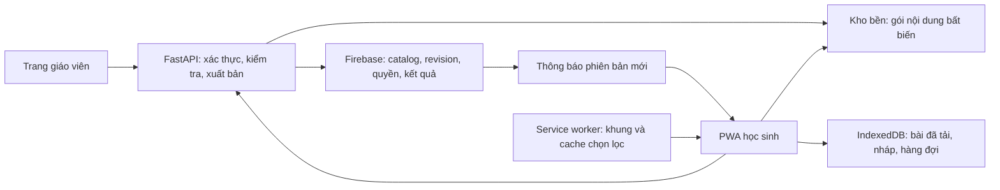

# PWA học sinh đa môn, không chatbot — kế hoạch 24/10/2026

Đây là kế hoạch thiết kế, chưa phải PWA đã triển khai. Thay thế định hướng bốn tab có Hỏi AI trong tài liệu mobile/PWA ngày 23/10 bằng phạm vi mới người dùng đã nêu. Không sửa/xóa chatbot của trang đầy đủ trong giai đoạn lập kế hoạch.

## Quyết định sau yêu cầu “làm sao cho hợp lý nhất”

Ưu tiên thiết kế trực tiếp từ mã nguồn của dự án và chuẩn web đã đối chiếu. Notebook là tham khảo trải nghiệm; REA/Antigravity là khảo sát hoặc phản biện tùy chọn, không là điều kiện để triển khai PWA. Chưa cần cài thêm engine dịch ngược, chuyển framework, chuyển toàn bộ DB hoặc viết lại ứng dụng.

Thứ tự hợp lý: kiểm tra quyền và nơi lưu dữ liệu bền → hợp đồng đa môn/phiên bản → bản học sinh riêng không chatbot → offline và cập nhật an toàn → pilot điện thoại thật. Bản đầu dùng Tin 9 hiện có cùng một môn thử nghiệm do giáo viên cung cấp; chỉ mở rộng sau khi chứng minh thêm/sửa môn qua dữ liệu mà không sửa code hay cài lại app.

Yêu cầu chuyển hai tệp khảo sát sang Antigravity đã bị bộ duyệt tự động chặn do chưa có chấp thuận cụ thể cho các tệp. Hai tệp vẫn ở máy. Phương án chính này được hoàn thiện bằng kiểm tra trực tiếp và tài liệu chính thức, không phụ thuộc việc gửi chúng ra ngoài.

## 1. Kết quả cần đạt

Học sinh cài ứng dụng từ website trên điện thoại; chọn môn/khối, học kiến thức, làm câu hỏi và bài tập, lưu nháp và xem tiến độ. Có thể tải bài đã chọn để học khi mạng yếu. Giáo viên xuất bản nội dung một lần, học sinh nhận bản mới khi có mạng, không cài lại app. PWA học sinh không có chatbot và không cần gọi Gemini để đọc bài, gợi ý hoặc chấm câu hỏi khách quan.

Không lấy “dịch ngược chính xác NotebookLM” làm điều kiện thành công. Bản cài đã thấy là ứng dụng Chrome; mã server Google không nằm trong shortcut hoặc biểu tượng. Khảo sát Notebook chỉ để tham khảo hành vi có bằng chứng. [Kiểm tra máy và REA](../audits/2026-10-24-rea-notebook-installation.md).

## 2. Hiện trạng đã đọc từ mã dự án

Mốc mã nguồn: main `7f19ee9`.

| Quan sát | Tác động khi làm PWA |
|---|---|
| frontend/app.js gộp lớp học, giáo viên, chatbot, thi và storage trong một tệp lớn | Không đóng gói cả tệp rồi chỉ ẩn nút chat; tách entry và module học sinh |
| getCurriculumToc chọn Tin 9 hoặc fallback Tin 6; nhiều nhãn/đường dẫn tin{grade} gắn cứng | Thêm môn phải qua mô hình dữ liệu đa môn, không thêm if/else và sửa HTML mỗi lần |
| initApp tự mở cửa sổ Socrates | Entry PWA không gọi khởi tạo chat |
| API bài học hiện định danh bằng grade/lesson_id | Cần subject/course/version để Bài 1 Toán không trùng Bài 1 Tin |
| Có danh mục tải từ API nhưng chưa có hợp đồng catalog đa môn/phiên bản phát hành | Cần API và quy trình xuất bản dữ liệu riêng |
| Chưa tìm thấy manifest/SW/đăng ký SW trong frontend ở lần rà soát này | Chưa có căn cứ gọi bản hiện tại là PWA offline hoàn chỉnh |
| Chấm quiz có hàm xác định đúng/sai từ dữ liệu gốc | Tái sử dụng phần thuần, tách khỏi agent/luồng AI |
| Có lưu JSON trên filesystem, đồng bộ Firebase và bản sao frontend | Chọn một nguồn dữ liệu bền có thẩm quyền, không coi bản JSON ở máy Render là nơi lưu chính |
| RTDB đang dùng; nháp/hàng đợi dùng localStorage | Cần IndexedDB bền qua lần đóng/mở và giao thức đồng bộ có ACK |
| 13 JSON curriculum và 4 JSON exams trong frontend có trường dap_an_dung/correct_answer | Phải phân loại và tạo gói học sinh đã lọc; không cache toàn bộ frontend/data |

API có giấu đáp án không đủ nếu đáp án vẫn có trong tệp tĩnh công khai. Cổng nghiệm thu phải kiểm tra toàn bộ artifact public, gồm đường dẫn cũ ngoài PWA mới.

Render mặc định mất các thay đổi filesystem khi restart/deploy nếu không có persistent disk. Dữ liệu do giáo viên xuất bản và bài học sinh cần nằm trong kho bền; cấu hình production thực tế phải được xác minh trước migration. [Render: persistent disks](https://render.com/docs/disks).

## 3. Kiến trúc đề xuất

Giữ FastAPI và Firebase hiện có ở bước đầu; không chuyển framework/DB chỉ vì thêm PWA. Tách các module thuần từ mã hiện tại, không sao chép nguyên app.js. Chọn kho object bền cho tệp/gói bài học sau khi kiểm tra tài khoản hạ tầng, dung lượng và quyền truy cập; chưa phê duyệt mua dịch vụ mới.

- PWA dự kiến: `/aisgk/hoc/`, entry riêng `frontend/student/`; tên thư mục là đề xuất, chưa được tạo.
- Trang giáo viên/phòng máy tiếp tục ở entry hiện có. SW chỉ kiểm soát `/aisgk/hoc/`, không chiếm trang giáo viên hoặc làm cache chatbot.
- Chỉ chia sẻ schema, parser bài học, hiển thị nội dung đã làm sạch, API client và logic chấm xác định. Teacher UI và tutor không nằm trong dependency graph của bundle học sinh.
- Không lưu nội dung giáo viên tạo chỉ ở Git hoặc filesystem tạm. Git chứa mã, migrations và fixture giả lập; không chứa bài nộp/hồ sơ thật.
- Một pipeline từ main sinh và phát hành artifact tĩnh, có kiểm tra hash; giảm việc chép thủ công hai phiên bản main/gh-pages như hiện nay. Sửa nội dung hằng ngày không cần chạy pipeline phát hành mã app.

## 4. Mô hình dữ liệu trước khi code

| Thực thể | Trường/hợp đồng cốt lõi |
|---|---|
| Subject | subject_id ổn định, tên, thứ tự, trạng thái |
| Course | course_id, subject_id, khối, học kỳ, nhóm được truy cập |
| Lesson | lesson_id ổn định, course_id, tiêu đề, các mục nội dung |
| Activity | activity_id, loại câu hỏi/bài tập, câu hỏi, tiêu chí chấm hoặc rubric |
| Package | package_id, content_version, schema_version, hash, kích thước, URL tài nguyên |
| Release | catalog_revision, tập package, thời điểm xuất bản, minimum_app_version |
| Assignment | assignment_id, lớp, hoạt động/phiên bản, thời hạn, chế độ ôn tập/đánh giá |
| Attempt | attempt_id, user_id từ phiên server, activity_id, content_version, câu trả lời, trạng thái |

ID không lấy từ tên hiển thị hay vị trí trong mảng. Đổi tên môn/bài không làm mất tiến độ. Khóa dữ liệu cục bộ gồm user_id + course_id + lesson/activity_id + content_version. Điểm chính thức do server xác nhận, không tin score hoặc user_id do trình duyệt tự khai.

Pydantic kiểm tra ở API; schema tương ứng ở trình duyệt. Gói không hiểu schema phải bị từ chối an toàn, vẫn mở được bản cũ đã tải. Đáp án/rubric bí mật lưu riêng phía server; gói học sinh chỉ có trường được cho phép.

API dự kiến, chưa triển khai:

- GET `/api/v3/catalog`: trả danh mục đúng quyền, revision, ETag.
- GET metadata gói bài và tải nội dung/tài nguyên bất biến theo hash.
- POST tạo/đồng bộ attempt: khóa chống trùng, phiên bản bài, trạng thái ACK rõ ràng.
- API giáo viên tạo nháp, xem trước, xác nhận xuất bản, thu hồi/rollback.

API mới tương thích với API cũ trong thời gian chuyển đổi; có adapter đưa Tin 6/Tin 9 hiện có sang subject_id=tin-hoc. Không đổi PIN trong công việc này.

## 5. Giáo viên thêm môn hoặc sửa bài

1. Tạo/chọn môn và khóa học, nhập nội dung thành bản nháp.
2. Kiểm tra schema, link/tệp, nội dung HTML đã làm sạch, quyền, phạm vi lớp và tính đầy đủ của câu hỏi.
3. Giáo viên xem trước giao diện điện thoại và phê duyệt nội dung/gợi ý/lời giải.
4. Tạo package có version/hash mới, lưu thành công vào kho bền trước.
5. Thực hiện cập nhật con trỏ release/catalog có tính nguyên tử. Không để học sinh thấy danh mục trỏ tới gói chưa tồn tại.
6. Phát revision mới. Ứng dụng đang mở kiểm tra; lần mở/focus/online kế tiếp cũng kiểm tra revision để bù sự kiện bị lỡ.
7. Tải phần thay đổi, kiểm tra schema/hash và chỉ chuyển bản khi gói đầy đủ. Lỗi/mất mạng giữa chừng giữ bản cũ.

Ví dụ nghiệm thu: giáo viên thêm Toán 9; điện thoại đã cài tự hiện môn mới khi online mà không thay JS/HTML hoặc cài lại. Sửa Tin 9 Bài 1 từ v1 sang v2; em đang làm v1 giữ nguyên bài đó tới khi xong, em bắt đầu mới dùng v2. Bài nộp luôn giữ phiên bản đã làm để chấm đúng.

## 6. Hai loại cập nhật khác nhau

**Nội dung:** kiểm tra catalog khi mở/focus/có mạng; khi foreground có thể dùng listener revision và polling dự phòng. Mục tiêu nghiệm thu trong mạng thử ổn định: phát hiện revision mới trong 60 giây khi app đang mở. Đây là mục tiêu cần đo, không phải số đã đạt. Chỉ cập nhật dữ liệu cần đổi; thêm môn không cần cập nhật mã app.

**Mã app:** trình duyệt kiểm tra SW mới; bản mới chuẩn bị trước và chờ thời điểm an toàn. Lưu nháp trước khi cho người dùng chuyển phiên bản; không ép reload khi đang làm bài. Mỗi lần phát hành cần phối hợp phiên bản cache, schema IndexedDB và API tương thích. [Vòng đời SW](https://web.dev/articles/service-worker-lifecycle), [cập nhật PWA](https://web.dev/learn/pwa/update).

Không hứa điện thoại chắc chắn tự tải nội dung khi ứng dụng đã đóng. Khả năng chạy nền phụ thuộc trình duyệt/hệ điều hành; phải bảo đảm cập nhật khi ứng dụng mở lại và có mạng. Push là thông báo tùy chọn về sau, không là điều kiện để môn/bài mới xuất hiện. [MDN: offline và background](https://developer.mozilla.org/en-US/docs/Web/Progressive_web_apps/Guides/Offline_and_background_operation).

## 7. Offline và đồng bộ

| Loại dữ liệu/chức năng | Chính sách đề xuất |
|---|---|
| Khung giao diện, font/icon cần thiết | Cache theo bản build, tài nguyên cùng bản |
| Catalog | Ưu tiên mạng với timeout; fallback bản tốt gần nhất và ghi rõ offline |
| Bài đã tải | Gói bất biến theo hash, tải chọn lọc; hiển thị dung lượng và phiên bản |
| Nháp/câu trả lời | IndexedDB theo tài khoản/phiên bản, lưu sau mỗi thay đổi |
| Nộp bài | Hàng đợi bền; chỉ báo Đã nộp khi server ACK; UUID chống gửi trùng |
| Điểm chính thức/đăng nhập/API giáo viên | Không cache công khai hoặc xem HTTP lỗi là dữ liệu thành công |
| Video/tệp lớn | Chọn tải riêng; không precache toàn bộ, có giới hạn dung lượng |

Trạng thái bài tập: Đang làm → Đã lưu trên máy → Chờ gửi → Đã nộp/Server từ chối cần xử lý. Gửi lại phải giữ attempt_id, không phát sinh bài nộp trùng. Người dùng đổi tài khoản không được gửi hàng đợi của tài khoản trước. Nội dung đã đổi hoặc bài đóng hạn cần phản hồi rõ; không tự gán điểm 0 khi lỗi mạng.

RTDB web không tự bảo đảm giữ hàng đợi ghi qua việc đóng trang. Do đó không thay IndexedDB bằng lời hứa SDK Firebase tự lo toàn bộ. [Firebase RTDB web offline](https://firebase.google.com/docs/database/web/read-and-write#work_with_data_offline).

Trình duyệt có thể thu hồi storage. Hiển thị trạng thái tải, xử lý hết dung lượng, cho xóa gói đã tải, không âm thầm xóa nháp chưa đồng bộ. Dọn cache cũ chỉ khi không còn attempt tham chiếu. [MDN: quota và eviction](https://developer.mozilla.org/en-US/docs/Web/API/Storage_API/Storage_quotas_and_eviction_criteria).

## 8. Học và làm bài không chatbot

- Học nội dung giáo viên duyệt; chia mục vừa màn hình, nhớ vị trí đọc.
- Câu hỏi từng bước, bấm cả hàng đáp án; gợi ý cố định do giáo viên soạn, không sinh từ Gemini lúc học sinh dùng app.
- Bài tự luận lưu nháp; học sinh nộp để giáo viên chấm/rubric có kiểm chứng. Không mặc định dùng AI viết lời giải hoàn chỉnh.
- Câu khách quan chấm bằng logic xác định phía server. Tách đường chấm/feedback PWA khỏi các nhánh gọi agent/Gemini; không chỉ bỏ nút chat ở frontend.
- MVP: offline đọc/làm/lưu nháp, có mạng mới xác nhận điểm. Nếu cần chấm tự động hoàn toàn offline, dữ liệu chấm phải ở máy; không thể bảo đảm giấu đáp án trước người có DevTools. Chỉ chọn chấm local cho bộ ôn tập được giáo viên cho phép, không cho đề đánh giá cần giữ bí mật.
- Test network và backend phải chứng minh đọc/làm/nộp trong luồng PWA không gọi `/api/chat` hay provider LLM. Giao diện không có chat/FAB/nhắc hỏi gia sư.

## 9. Cài lên điện thoại và giao diện

Manifest có id ổn định, name/short_name, lang=vi, display=standalone, icon thích hợp; start_url/scope bám `/aisgk/hoc/`. SW và asset URL phải chạy đúng khi đặt dưới thư mục GitHub Pages, không giả định domain root. HTTPS; deep link, refresh, offline navigation và các URL ngoài scope đều được kiểm tra. [MDN: cài PWA](https://developer.mozilla.org/en-US/docs/Web/Progressive_web_apps/Guides/Making_PWAs_installable), [manifest scope](https://developer.mozilla.org/en-US/docs/Web/Progressive_web_apps/Manifest/Reference/scope).

Điện thoại: Môn học / Bài tập / Đã tải / Tiến độ; hồ sơ ở thanh trên. Có Tiếp tục học, lưu nháp tự động, nút quay lại không mất bài. Ghi rõ Đang offline/Đã lưu máy/Chờ đồng bộ. Bài thực hành cần máy tính phải có nhãn, không tuyên bố làm đủ trên điện thoại.

Android có luồng cài của trình duyệt hỗ trợ; iPhone hướng dẫn Safari → Chia sẻ → Thêm vào Màn hình chính, tùy phiên bản hệ điều hành. Không hứa cùng một nút cài trên mọi máy. [Apple: web app trên iPhone](https://support.apple.com/guide/iphone/iphea86e5236/ios).

## 10. Quyền truy cập và dữ liệu trường học

Trước pilot phải kiểm tra rules thật trên Firebase. Trong đợt dọn dữ liệu cùng phiên làm việc, REST không kèm token đã đọc/xóa được các nhánh kết quả; đây là bằng chứng cần khắc phục, không được suy ra production đã bảo vệ chỉ vì database.rules.json trong Git có quy tắc deny. Không thử ghi/xóa dữ liệu production thêm để kiểm tra.

Phân quyền giáo viên xuất bản, học sinh đọc đúng lớp/môn và chỉ nộp bài cho mình phải do server/rules kiểm tra. Kiểm thử policy bằng Emulator/staging, sau đó xác nhận read-only quyền production. Cache học sinh không chứa hồ sơ cả lớp, token giáo viên, mật khẩu hay đề/đáp án bí mật. [Firebase Security Rules](https://firebase.google.com/docs/database/security).

Đăng xuất/đổi tài khoản dọn hoặc khóa namespace riêng; giải quyết nháp chưa gửi có thông báo. Thu hồi quyền có hiệu lực khi thiết bị liên lạc lại; không hứa xóa tức thời bài đã tải ở điện thoại mất mạng. Giữ cơ chế reset dữ liệu lần trước như migration lịch sử, không dùng xóa toàn bộ cache/kết quả làm cách cập nhật bài mới.

## 11. Lộ trình và cổng nghiệm thu

| Giai đoạn | Việc làm | Bằng chứng để chuyển bước |
|---|---|---|
| 0. Chốt bằng chứng | Hồ sơ REA/Notebook; phạm vi no-chat; hạ tầng bền, rules, backup | Phân biệt đã đo/đề xuất/chưa biết; không tự nhận đã dịch ngược |
| 1. Hợp đồng đa môn | Schema, adapter Tin 6/9, version/attempt, quyền, publish | Một môn thử mới không sửa code UI; không trùng ID, draft không xuất hiện |
| 2. Entry học sinh | Module riêng, bốn màn hình, nháp/tiến độ, chấm không AI | Dùng được mobile; không tải tutor/teacher bundle; không gọi chatbot |
| 3. Cài và offline | Manifest/icon/SW, IndexedDB, tải chọn lọc, outbox | Cài/mở từ icon; restart offline; ACK/idempotency; đổi tài khoản an toàn |
| 4. Cập nhật | Catalog revision, download nguyên tử, SW chờ an toàn, rollback | Sửa/thêm môn tới thiết bị đã cài; không mất bài v1 đang làm |
| 5. Pilot | Android cấu hình thấp và iPhone thật; staging tách production | Học sinh hoàn thành luồng; dữ liệu thật không trộn fixture; giáo viên kiểm tra kết quả |

Không hứa thời gian hoàn thành chính xác trước khi chốt schema, nội dung, thiết bị và hạ tầng. Mỗi giai đoạn có artifact và gate, không lấy điểm Lighthouse đơn lẻ làm nghiệm thu.

## 12. Bộ kịch bản bắt buộc

1. Cài lần đầu trên Android và iPhone; mở từ icon và link được chia sẻ.
2. Thêm môn mới ở trang giáo viên; ứng dụng đã cài nhận đúng lớp, không cài lại.
3. Sửa bài, đổi tên môn/bài, reorder; không mất ID hoặc tiến độ.
4. Publish lỗi khi upload gói chưa xong; catalog cũ vẫn hợp lệ.
5. Mạng mất giữa tải; không dùng gói mới thiếu tài nguyên.
6. Làm dở v1 rồi giáo viên publish v2; tiếp tục và chấm theo v1.
7. Server rollback; bài/attempt đã làm không bị sửa lịch sử.
8. Đóng hẳn trình duyệt/khởi động máy khi offline; mở lại bài đã tải và nháp.
9. Nộp lại sau timeout hoặc mở hai tab; một attempt chỉ được ghi một lần.
10. Phiên hết hạn, đổi tài khoản, khóa học sinh; không lộ/gửi nhầm nháp.
11. Hết storage hoặc bị hệ điều hành thu hồi; báo đúng, phục hồi dữ liệu đã đồng bộ.
12. App/SW cập nhật khi đang làm câu; không reload hoặc xóa đáp án âm thầm.
13. Không cache lỗi 401/403/500 thành nội dung bài; không lấy draft làm fallback.
14. Quét artifact public: không có dữ liệu học sinh, private answer keys hoặc secret.
15. Câu luyện tập đúng/sai, gợi ý, nộp bài: không có request chatbot/LLM.
16. Bài tự luận/đính kèm: lưu nháp, báo dung lượng, gửi lại an toàn và giáo viên nhận được.
17. 360/390/412px, bàn phím ảo, safe-area, chữ lớn, screen reader và bàn phím.
18. Ứng dụng đóng không có background sync: mở lại vẫn cập nhật đúng.
19. Nội dung chứa HTML/link không an toàn bị chặn/sanitize trước hiển thị.
20. Regression trang giáo viên/desktop/AI hiện có và quy trình không trộn dữ liệu test.

## 13. Hồ sơ bàn giao Antigravity

[Yêu cầu phân tích REA/Notebook](2026-10-24-antigravity-rea-pwa-task.md) là prompt ngắn, chỉ dẫn đọc file và giới hạn phạm vi. Không gửi notebook riêng, screenshot hay bundle nặng vào prompt. Kết quả phân tích đối chiếu phải ghi rõ bằng chứng, unknown và điều kiện thực thi; không suy đoán backend Notebook rồi dùng như kiến trúc đã xác minh.
